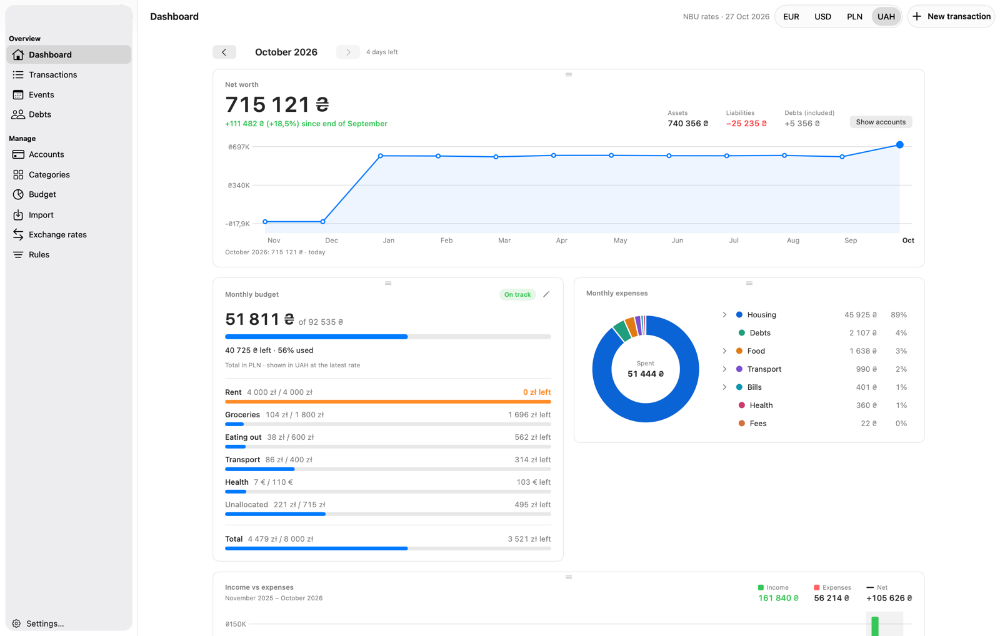
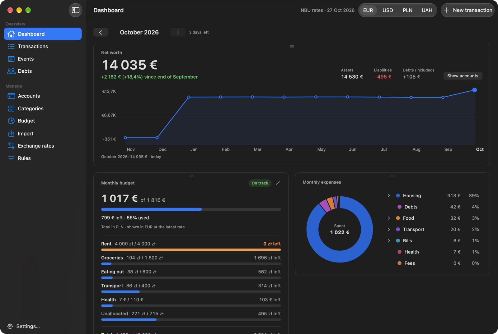
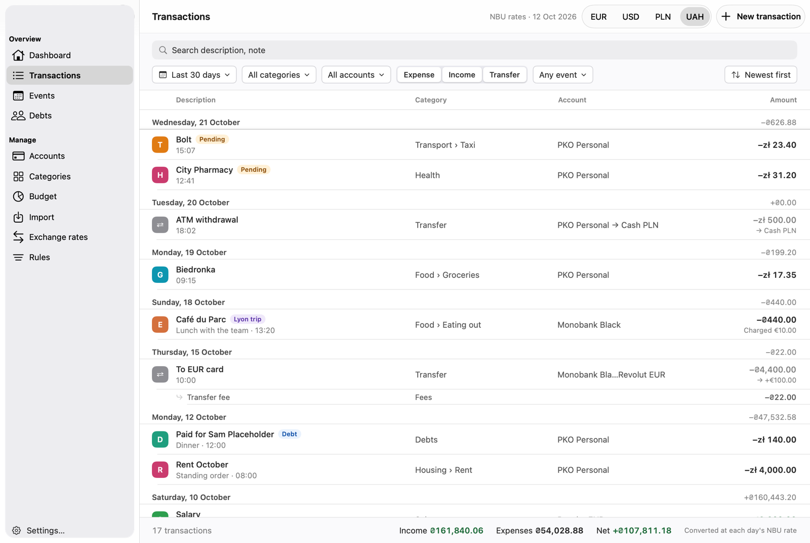
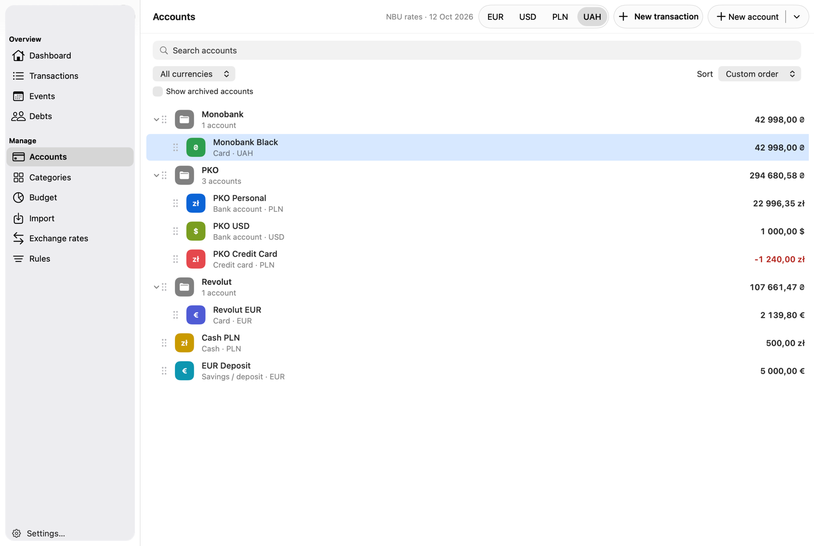
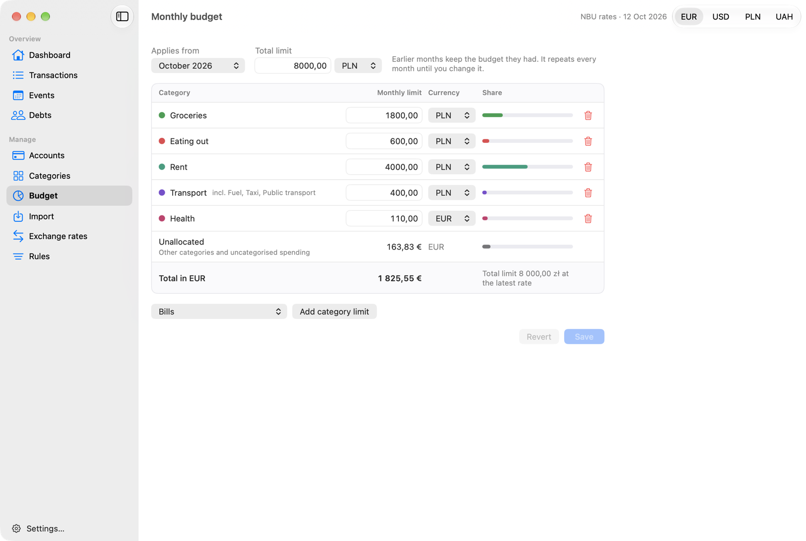
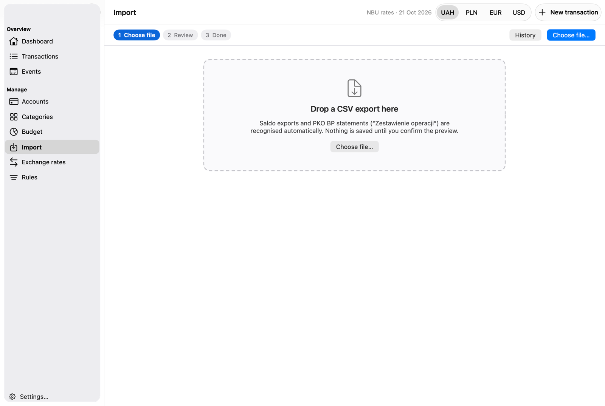
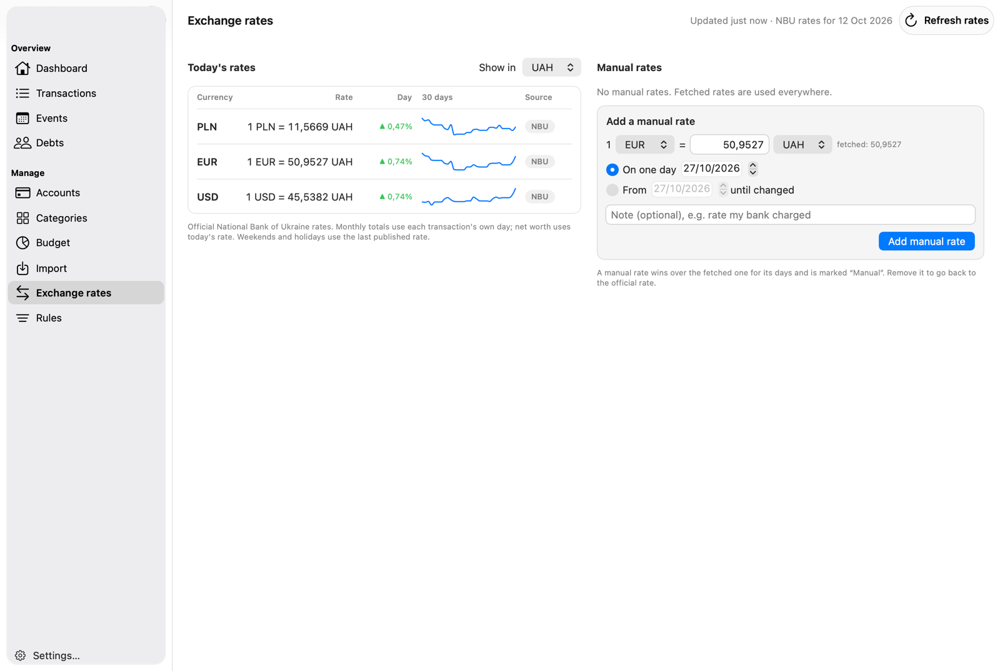
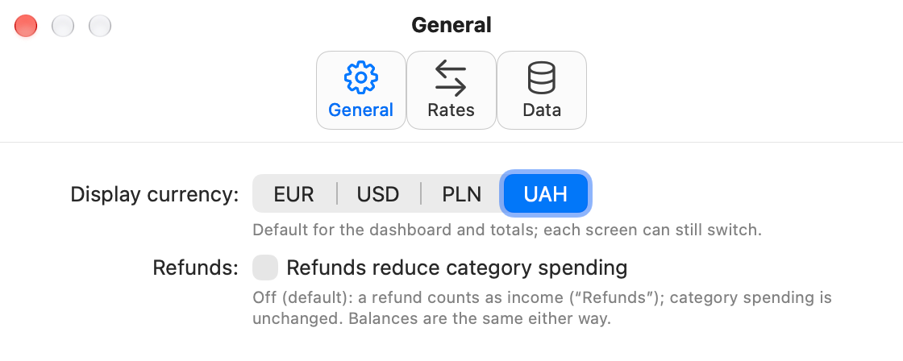

# Abacus

A personal finance tracker for macOS. Abacus keeps your accounts in UAH, PLN, EUR and USD in one
place, converts everything at official National Bank of Ukraine (NBU) rates, and gets most of
your history in by importing files instead of typing them: a Saldo export and PKO BP bank
statements.

Everything is stored on your Mac. There are no bank connections, no accounts to sign up for and
no telemetry; the only network traffic is fetching exchange rates.



## Features

- **Dashboard**: net worth with a 12-month chart (assets minus liabilities, converted at the
  latest rate), the month's budget with per-category bars, and a monthly expenses donut. Click a
  slice to see its transactions. Switch the display currency (UAH, PLN, EUR, USD) at any time.
- **Accounts**: cash, bank accounts, cards, savings, investments, credit cards, loans and personal
  debts, in groups, with opening balances. Archive old accounts to keep their history out of
  net worth.
- **Transactions**: expenses, income and transfers (also between currencies), refunds, and
  attached lines for fees, cashback or splitting one payment across categories. You can pay in
  any currency and record what the account was actually charged. Pending bank holds are marked
  until they settle.
- **Transaction list**: last 30 days by default, grouped by day, with filters for date, category,
  account, type and event, text search, and income / expense / net totals for what you see.
- **Categories** with one level of subcategories, a **monthly budget** split across categories,
  and **events** (a trip, a move, the car) that collect spending across categories.
- **Import** with a preview before anything is saved: Saldo CSV exports (accounts, categories,
  transfers and tags as events) and PKO BP "Zestawienie operacji" CSV statements. Re-importing an
  overlapping file never creates duplicates, likely duplicates from other sources are flagged,
  your choices become categorisation rules for next time, and any import can be undone.
- **Exchange rates**: official NBU rates fetched on launch and daily, cached for offline use,
  with a 30-day history per currency. Set a manual rate for a day, or from a day on, when your
  bank charged something else.
- **Settings**: default display currency, how refunds are counted, automatic rate updates, and
  backup export / restore.

The full functional description is in the [tech assignment](docs/REQUIREMENTS.md).

## Screenshots

All screenshots show the built-in sample data (synthetic).

<table>
  <tr>
    <td align="center" valign="top">
      <br>
      <sub>Dashboard, dark mode</sub>
    </td>
    <td align="center" valign="top">
      <br>
      <sub>Transactions</sub>
    </td>
  </tr>
  <tr>
    <td align="center" valign="top">
      <br>
      <sub>Accounts</sub>
    </td>
    <td align="center" valign="top">
      <br>
      <sub>Monthly budget</sub>
    </td>
  </tr>
  <tr>
    <td align="center" valign="top">
      <br>
      <sub>Import, step 1</sub>
    </td>
    <td align="center" valign="top">
      <br>
      <sub>Exchange rates</sub>
    </td>
  </tr>
  <tr>
    <td align="center" valign="top" colspan="2">
      <br>
      <sub>Settings › General</sub>
    </td>
  </tr>
</table>

## Requirements

- macOS 26 or later (Apple silicon or Intel).

## Install

1. Get `Abacus-<version>.dmg`: from the repository's **Releases** page when a release is
   published, or build it yourself (see [Building from source](#building-from-source)).
2. Open the DMG and drag **Abacus** to **Applications**.
3. The app is **ad-hoc signed and not notarized**, so Gatekeeper blocks the first launch. Either
   right-click **Abacus.app › Open** once and confirm, or clear the quarantine flag:

   ```bash
   xattr -dr com.apple.quarantine /Applications/Abacus.app
   ```

To check the download, compare `shasum -a 256 Abacus-<version>.dmg` with the published
`.sha256` file.

## First steps

Abacus starts empty. Pick one:

- **Import a Saldo export**: in the Saldo app, export your data as CSV, then in Abacus open
  **Import** (sidebar), choose or drop the file, review the preview and click Import. Accounts,
  categories and opening balances are created for you; transfers recorded as two halves are paired.
- **Import a PKO BP statement**: in PKO BP online banking, export the account history as CSV
  ("Zestawienie operacji"), then import it the same way and pick the Abacus account it belongs to
  (remembered for next time). Import newer statements whenever you like: rows already imported
  are skipped and pending card holds are updated when they settle.
- **Just look around**: **Help › Load Sample Data** fills an empty database with synthetic
  accounts, transactions and a budget. It does nothing if you already have data.

Then add transactions by hand with **New transaction** (⌘N). Sections are on ⌘1…⌘9, Refresh
Rates is ⌘R, Settings is ⌘,.

## Your data

- **Location**: one SQLite database in
  `~/Library/Application Support/Abacus/abacus.sqlite` (with its `-wal` and `-shm` files).
  **Settings › Data › Show in Finder** opens the folder.
- **Backup**: **Settings › Data › Export backup…** writes all your data to a single
  `.abacus` file; keep it somewhere safe (another disk, a cloud folder). **Restore from backup…**
  replaces everything in the app with the backup's contents, after asking you to confirm.
  Time Machine also backs up the database folder.
- **Privacy**: data never leaves your Mac. The only network requests are for exchange rates:
  NBU rates via the Frankfurter API (`api.frankfurter.dev`) with the NBU's own API
  (`bank.gov.ua`) as a fallback. Turn off automatic updates in **Settings › Rates** to fetch
  only when you click Refresh rates.

## Building from source

Requirements: Xcode with the macOS 26 SDK (built and tested with Xcode 27), and [XcodeGen](https://github.com/yonaskolb/XcodeGen)
(`brew install xcodegen`). The Xcode project is generated from [`project.yml`](project.yml);
the generated `Abacus.xcodeproj` is committed, so you can also just `open Abacus.xcodeproj`.
If `xcode-select` points at the Command Line Tools, prefix the commands with
`DEVELOPER_DIR=/Applications/Xcode.app/Contents/Developer`.

```bash
# Release DMG: generates the project, builds an ad-hoc signed Release,
# writes dist/Abacus-<version>.dmg and prints its SHA-256
scripts/build-dmg.sh

# Core package: build and run all tests (from AbacusKit/)
cd AbacusKit && swift test && cd ..

# Regenerate the Xcode project after changing project.yml
xcodegen generate --spec project.yml

# Debug build of the app (macros need -skipMacroValidation on the command line)
xcodebuild -project Abacus.xcodeproj -scheme Abacus -destination 'platform=macOS' \
  -derivedDataPath build.noindex -skipMacroValidation build
```

The app is a thin SwiftUI shell (`App/macOS`); domain, currency math, storage, importers and
view models live in the local Swift package [`AbacusKit`](AbacusKit).

## Changes

See [CHANGELOG.md](CHANGELOG.md).

## Project docs

- [Tech assignment](docs/REQUIREMENTS.md): requirements with stable `R-…` IDs.
- [Execution plan](docs/PLAN.md) and [status](docs/STATUS.md).
- [Decisions](docs/DECISIONS.md).
- [Screen designs](docs/design/README.md).
- Import formats: [Saldo](docs/import/saldo-format.md), [PKO BP](docs/import/pko-format.md).
- [Contributor guide](AGENTS.md): working rules, build facts and the code map.
